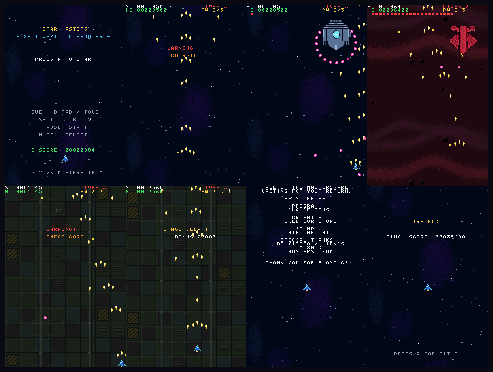

# STAR MASTERS

8bit風のドット絵で作った縦スクロールシューティング。
**ブラウザ版**と**ニンテンドーDS版**の2つがあり、同じゲームを同じ素材から動かしている。

全3ステージ、各ステージ末にボス、3体倒すとエンディング(スタッフロール)。



*↑ DS版(melonDS 1.1 実測): タイトル / WARNING / ボス1 / ボス2 / 最終ボス / STAGE CLEAR / スタッフロール / THE END*

## 2つの版

| | [`shooter/`](shooter/) | [`shooter-nds/`](shooter-nds/) |
|---|---|---|
| 動作環境 | ブラウザ | ニンテンドーDS / DSi / 3DS(フラッシュカート) |
| 実装 | JavaScript + [enchant.js](https://github.com/wise9/enchant.js) | C + devkitARM / libnds / maxmod |
| 画面 | 320x480 | 256x384(上下2画面を縦に連結) |

### ブラウザ版を遊ぶ

```sh
cd shooter
python3 -m http.server 8123
# → http://localhost:8123/
```

移動: 矢印キー / WASD、ショット: Z または Space、ポーズ: P、ミュート: M。
スマホのタッチ操作にも対応。

### DS版を遊ぶ

ビルド済みの `shooter-nds/star-masters.nds` を microSD にコピーして、
DSpico などのフラッシュカートから起動する。

自分でビルドする場合(ホストに devkitPro を入れる必要はない):

```sh
cd shooter-nds
docker run --rm -v "$PWD:/w" -w /w devkitpro/devkitarm:latest make
```

移動: 十字キー / 下画面タッチ、ショット: A B X Y、ポーズ: START、ミュート: SELECT。

## 素材は両版で共有している

ドット絵とBGM/SEは Python の生成スクリプト(標準ライブラリのみ、外部依存なし)で作っている。
DS版用の変換スクリプトはブラウザ版の生成スクリプトを import して
ドット絵のグリッドや音符データを再利用しているので、**元の絵や曲を直せば両方に反映される。**

```sh
cd shooter
python3 tools/generate_images.py       # ブラウザ版のPNG
python3 tools/generate_audio.py        # ブラウザ版のWAV
python3 tools/generate_nds_gfx.py      # DS版のタイルデータ (C配列)
python3 tools/generate_nds_audio.py    # DS版のMOD + SE
```

各スクリプトは最後に自己検証を行い、寸法・色数・音量・ループ長などが
仕様から外れていれば非ゼロ終了する。

### DS版で変換が必要な理由

| | ブラウザ版 | DS版 | 理由 |
|---|---|---|---|
| スプライト | 32x32 PNG(原画x2) | 16x16 8bpp タイル(原画x1) | DSのスプライトは 8/16/32/64 のみ、最大64x64 |
| ボス | 96x96 | 64x64(原画を描き足し) | 96x96 はDSのスプライト最大サイズを超える |
| 背景 | 320x480 PNG | 256x256 タイル+マップ | DSのBGはタイル方式 |
| BGM | WAV 計5.4MB | MODモジュール 計44KB | DSのメインRAMは4MB、WAVでは載らない |
| SE | WAV 22050Hz 16bit | WAV 11025Hz 8bit | RAM節約 |
| 文字 | Canvasのフォント描画 | 8x8 ビットマップフォント | DSにフォント描画機構はない |

## ゲーム内容の調整

難易度・ステージ構成は1ファイルで完結する。

- ブラウザ版: [`shooter/js/config.js`](shooter/js/config.js)
- DS版: [`shooter-nds/source/stages.c`](shooter-nds/source/stages.c)

敵の出現時刻・種類・数・移動パターン・弾の頻度がテーブルになっている。
DS版の値はブラウザ版の x0.8(320x480 → 256x384 は縦横比が同じなので、
長さと速度を一律に縮めるだけでバランスがそのまま移る)。

## 素材の出所

**ドット絵・BGM・SE・ゲームコードはすべて新規に作ったもの**で、外部から取り込んだ
素材は一切含まれていない。ドット絵は `generate_images.py` 内のASCIIグリッド、
BGMは `generate_audio.py` 内の音符データ(小節・拍・音高)として
ソースに直接書かれており、スクリプトを実行すると同じ結果が再現できる。
生成スクリプトはPython標準ライブラリのみを使い、ネットワークアクセスも
外部ファイルの読み込みも行わない。

第三者のソフトウェアは以下の3点のみで、いずれも許諾範囲内で使っている。
詳細とライセンス全文は [THIRD-PARTY-NOTICES.md](THIRD-PARTY-NOTICES.md) を参照。

| | ライセンス | どこで使っているか |
|---|---|---|
| [enchant.js](https://github.com/wise9/enchant.js) v0.8.3 | MIT | `shooter/lib/enchant.js` として同梱 |
| libnds | zlib風 | DS版ROMに静的リンク |
| maxmod | ISC | DS版ROMに静的リンク |
