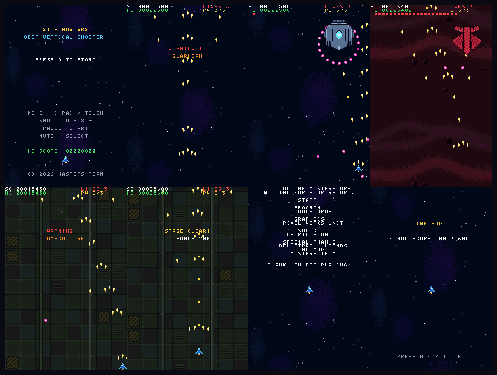

# STAR MASTERS (Nintendo DS)

`../shooter/` の enchant.js 版を **devkitARM + libnds + maxmod** でDS用に作り直したもの。
DSpico などのフラッシュカートで実機動作する `.nds` を吐く。

全3ステージ、各ステージ末にボス、3体倒すとエンディング(スタッフロール)。



上の画像は melonDS 1.1 上での実測(タイトル / WARNING / ボス1 / ボス2 /
最終ボスWARNING / STAGE CLEAR / スタッフロール / THE END)。

## ビルド

ホストに devkitPro を入れる必要はない。Docker イメージだけで完結する。

```bash
docker run --rm -v "$PWD:/w" -w /w devkitpro/devkitarm:latest make
```

`star-masters.nds` ができる。`make clean` で中間物を消せる。

## 実機(DSpico)で遊ぶ

1. microSD をFAT32でフォーマットし、DSpico のファームウェア/Pico Launcher を導入済みにする
2. `star-masters.nds` を microSD の任意のフォルダにコピー
3. DSpico を DS / DS Lite / DSi / 3DS に挿し、Pico Launcher から選んで起動

homebrew の `.nds` なので特別なパッチは不要(Pico Loader が自動でDLDIパッチを当てる)。
セーブは行わないためハイスコアは電源を切ると消える。

## エミュレータで確認する

```bash
open -a melonDS star-masters.nds
```

**注意: melonDS 1.1 は初期状態でキー割り当てが空**なので、初回に
Config → Input and hotkeys でキーボードまたはパッドを割り当てる必要がある。

DeSmuME は 0.9.11 / 0.9.13 のどちらも、この新しい libnds(calico ベース)で
ビルドした ROM を実行できない(公式の hello_world サンプルも白画面になる)。
確認には melonDS を使うこと。

## 動作確認用ビルド

入力なしで進行を確認できるビルドを2種類用意している。製品ROMには一切影響しない
(フラグ未定義時はすべて 0 に畳み込まれる)。

```bash
# ボス出現までを短縮・ボスHP減・無敵・自動連射・自動照準・タイトル自動開始
docker run --rm -v "$PWD:/w" -w /w devkitpro/devkitarm:latest make CFLAGS_EXTRA=-DTEST_FAST

# ボタン入力を台本化(左→右→上→下を繰り返す)。移動と画面端クランプの確認用
docker run --rm -v "$PWD:/w" -w /w devkitpro/devkitarm:latest make CFLAGS_EXTRA=-DTEST_INPUT

# 中ボスが合体するまで自動連射を止める(合体後の形態を確認する用)
docker run --rm -v "$PWD:/w" -w /w devkitpro/devkitarm:latest make CFLAGS_EXTRA="-DTEST_FAST -DTEST_MB_LETMERGE"

# 中ボスを出さずステージを流す(地上物の確認用)
docker run --rm -v "$PWD:/w" -w /w devkitpro/devkitarm:latest make CFLAGS_EXTRA=-DTEST_GROUND

# 中ボス戦で自機を最良位置に固定する(ボーナス達成の確認用)
docker run --rm -v "$PWD:/w" -w /w devkitpro/devkitarm:latest make CFLAGS_EXTRA="-DTEST_FAST -DTEST_MB_POS"

# 合体猶予中にコアへ何発当たるか実測する(HUDに MERGE HITS を表示)
docker run --rm -v "$PWD:/w" -w /w devkitpro/devkitarm:latest make CFLAGS_EXTRA="-DTEST_FAST -DTEST_MB_COUNT -DTEST_MB_DX=13 -DTEST_MB_Y=160"

# 中ボスの真っ最中に自動でポーズする(ポーズが効いているかの確認用)
docker run --rm -v "$PWD:/w" -w /w devkitpro/devkitarm:latest make CFLAGS_EXTRA="-DTEST_FAST -DTEST_PAUSE"

# デモプレイ(アトラクトモード)を短時間で見る: タイトル無操作1秒でデモ開始、各ステージ10秒
docker run --rm -v "$PWD:/w" -w /w devkitpro/devkitarm:latest make CFLAGS_EXTRA="-DDEMO_IDLE_FRAMES=60 -DDEMO_STAGE_FRAMES=600"
```

`TEST_FAST` ならタイトル→3ステージ→各ボス→エンディングを数分で通せる。

## 操作

| 操作 | ボタン |
|---|---|
| 移動 | 十字キー / 下画面タッチ |
| ショット | A / B / X / Y(押しっぱなしで連射) |
| ポーズ | START |
| ミュート | SELECT |

タッチ操作中はオート連射。指の少し上に自機が追従する。
タイトルで15秒間何も操作しないとデモプレイが始まる(ボタン・十字キー・タッチで終了してタイトルへ戻る)。

## 画面構成

DSは1画面 256x192 なので、**上下2画面を縦に連結して 256x384 の縦長プレイフィールド**として扱う。

```
┌────────────────┐
│ 上画面  フィールド y   0..191 │  HUD(スコア/残機/ボスHP)を上端に重ねる
│                              │  敵・ボスが出現
└────────────────┘
     ≒ ベゼルの物理的な隙間 ≒
┌────────────────┐
│ 下画面  フィールド y 192..383 │  自機がいる領域 / タッチ操作
└────────────────┘
```

元の 320x480 と 256x384 は縦横比が同じ(1:1.5)なので、
**長さ・速度をすべて x0.8 するだけでゲームバランスがそのまま移る**。

## ファイル構成

```
shooter-nds/
├── Makefile              … devkitARM の ds_rules を使う標準構成
├── include/
│   ├── game.h            … 定数・エンティティ型
│   ├── stages.h          … ステージ定義の型
│   ├── gfx.h             … 描画API
│   ├── sound.h           … 音API
│   └── gfx_data.h        … 【生成物】スプライト/背景/フォントのメトリクス
├── source/
│   ├── main.c            … 起動とメインループ
│   ├── game.c            … ゲーム本体(Web版 entities.js + scenes.js の移植)
│   ├── stages.c          … 全3ステージの出現テーブル(config.js の移植)
│   ├── gfx.c             … 2画面スプライト管理・背景スクロール・文字描画
│   ├── sound.c           … maxmod ラッパ
│   └── gfx_data.c        … 【生成物】ドット絵・背景・フォントのバイナリ
└── audio/                … 【生成物】BGM 6曲(.mod) + SE 8種(.wav)
```

## アセットの作り直し方

**画像・音の元データは Web版と共有している。**
`../shooter/tools/` の生成スクリプトが、Web版用とDS版用の両方を吐き出す。

```bash
cd ../shooter
python3 tools/generate_nds_gfx.py     # → shooter-nds/source/gfx_data.c, include/gfx_data.h
python3 tools/generate_nds_audio.py   # → shooter-nds/audio/*.mod, *.wav
```

どちらのスクリプトも Web版の `generate_images.py` / `generate_audio.py` を
import してドット絵のグリッドや音符データを再利用しているので、
**元の絵や曲を直せば Web版とDS版の両方に反映される。**

Web版用のアセット(`../shooter/assets/`)は上記スクリプトでは変更されない。

### DS版で変換が必要な理由

| | Web版 | DS版 | 理由 |
|---|---|---|---|
| スプライト | 32x32 PNG (原画x2) | 16x16 8bpp タイル (原画x1) | DSのスプライトは 8/16/32/64 のみ。最大64x64 |
| ボス | 96x96 | 64x64 (原画を描き足して拡大) | 96x96はDSのスプライト最大サイズを超える |
| 背景 | 320x480 PNG | 256x256 タイル+マップ | DSのBGはタイル方式。縦にシームレス |
| BGM | WAV 計5.4MB | MODモジュール 計44KB | DSのメインRAMは4MB。WAVでは載らない |
| SE | WAV 22050Hz 16bit | WAV 11025Hz 8bit | RAM節約 |
| 文字 | Canvas のフォント描画 | 8x8 ビットマップフォント | DSにフォント描画機構はない |

## 実装上の制約と対処

- **スプライト128個/画面**: DSのハードウェア上限。敵弾の同時数を80発に抑え、
  ボスの全方位弾を24発→20発に減らしている。描画は
  自機→ボス→敵→敵弾→自弾→アイテム→爆発の優先度順で、
  万一128個に達したら後ろのものが落ちる。
- **半透明が使えない**: 被弾点滅は opacity ではなく表示/非表示のトグルにした
  (結果的に8bitらしくなっている)。
- **文字色**: フォントのドットは全てパレット値1で、4bppBGのパレットバンクを
  切り替えて色を変えている。背景(8bpp)がBGパレット0..127しか使わない前提で、
  バンク8..15を文字色に割り当てている。
- **エンティティの経過時間**は各自のカウンタで持っている(ポーズで正しく止まる)。

## 追加要素(地上物 / 中ボス)

ブラウザ版と同じ仕様。詳細は [../shooter/README.md](../shooter/README.md) を参照。

- **地上物**: 背景と同速度で流れる固定設置物。通常ショットで破壊可。
  DSではスプライト優先度3で描き、他のスプライトより奥に置いている
- **中ボス**: パーツが画面外から飛来 → コアの四方で1秒静止 → 1秒で合体。
  パーツは静止した時点から**無敵の障害物**(ショットを弾き、接触で自機が死ぬ)。
  合体までは狙えるのはコアだけで、**12発**当てると50000点。
  **合体と同時にパーツの無敵は解除**され、以降はどこに当てても8発で1000点
  (盾のままだとコアの中央が塞がって倒せなくなるため)。
  パーツの合体位置は `MB_ATTACH_R`(12px)で、これはスプライト同士の
  噛み合わせなのでブラウザ版の x0.5(他の距離は x0.8)

  必要弾数はDS版だけ12発(ブラウザ版は14発)。melonDS上での実測値:

  | 自機の位置 | 合体猶予中にコアへ当たる数 |
  |---|---|
  | 後方中央 (dx=0, y=280) | **0発**(下パーツが完全に遮る) |
  | 中間 (dx=6, y=220) | 9発 |
  | 踏み込み (dx=13, y=160) | **19発** |

  測定は `-DTEST_MB_COUNT -DTEST_MB_DX=n -DTEST_MB_Y=n` でビルドすると
  HUDに `MERGE HITS` が出る(コアのHPは事実上無限になる)。

## 難易度・ステージ構成の調整

`source/stages.c` のテーブルだけで完結する。列の意味は `include/stages.h` を参照。
自機の速度・連射間隔・残機・当たり判定は `include/game.h` の `PLAYER_*`。
